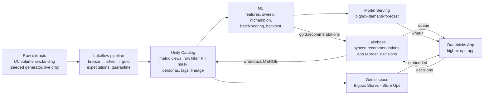

# Bigbox Stores: near-real-time on-shelf availability

## Outcome

On the same simulated demand and suppliers, the ML reorder policy cut **lost sales to stockouts by
33.7 %**, raised **on-shelf availability by 2.16 points** and cut **perishable shrink by 33.9 %**
against the incumbent nightly policy over the 8 held-out weeks
([backtest](evidence/03b_backtest_value.md)). At a ~$1B retailer and 50 % realisation that is worth
about **$11.0M a year** ([value model](evidence/03b_backtest_value.md)), for a run cost of
$218,470 a year, **50 $ of value per $ of run cost** ([cost](evidence/07_cost.md)).
**Time to value:** a stockout reaches the planner's queue within one 15-minute refresh (one run
took about 8 minutes from new files to the Lakebase queue, [evidence](evidence/04_lakebase.md)),
instead of the next morning. Everything is deployed: pipeline, governance, model and endpoint,
Lakebase, Genie (25 of 25 benchmark questions in each of 3 runs, [evidence](evidence/05_genie.md))
and the app, smoke-tested on its deployed URL ([evidence](evidence/06_app.md)).

All data is synthetic, from a seeded generator. Bigbox Stores is fictional; no real customer data or
names are used. All results are on simulated data; see "Out of scope" for what that means.

## The problem and the decision improved

A big-box retailer (~100 stores, in-store and online, ~$1B revenue) sees yesterday's sales only after
a nightly batch, so a stockout is noticed a day late and slow movers are over-ordered. Its forecast is
trained on censored demand: an empty shelf records zero sales, not zero demand. Two BI tools each
carry their own KPI logic.

This build improves one decision, every day: **what to reorder, for which store and SKU, today**,
measured by lost sales avoided and overstock and waste reduced.

## Architecture



`bigbox_refresh` runs every 15 minutes (paused by default): pipeline → incremental features →
incremental scoring → Lakebase sync, with the decisions write-back in parallel.

## What was built, per stage

| stage | built | evidence |
|---|---|---|
| 0 Raw data | Seeded generator: masters, hourly demand meeting the incumbent's stock, 14 injected defect types, ground truth on the side; live micro-batches | [00](evidence/00_raw_data.md), [00b](evidence/00b_live_drip.md) |
| A Lakeflow | One serverless pipeline: Auto Loader bronze, typed silver with expectations and quarantine, additive gold; every defect type reconciles | [01](evidence/01_lakeflow.md) |
| B Unity Catalog | Three persona service principals, table grants, region row filter, PII mask, two metric views, comments, governed tags, lineage | [02](evidence/02_unity_catalog.md), [02b](evidence/02b_catalog_metadata.md) |
| C ML | UC feature table, six candidates on one holdout, `@champion` / `@challenger`, batch scoring, tonight's recommendations, serving endpoint with exact parity, backtest and value model | [03](evidence/03_ml.md), [03b](evidence/03b_backtest_value.md) |
| D Lakebase | Autoscaling project, triggered synced table, insert-only decisions table, write-back MERGE to Delta | [04](evidence/04_lakebase.md) |
| E Genie | Curated space over the metric views and gold tables; 25 questions scored against reference SQL, 3 runs, plus an ablation | [05](evidence/05_genie.md) |
| F App | AppKit app: KPI header, at-risk queue, what-if on the endpoint, approve / override / reject, Genie; deployed with 4 bundle bindings and a least-privilege service principal | [06](evidence/06_app.md) |
| Cost | Build cost to date, unit costs, monthly run cost, ROI, from billing at list price | [07](evidence/07_cost.md) |

[`evidence/INDEX.md`](evidence/INDEX.md) lists every evidence file with its claim and size.

## How to reproduce

Prerequisites: Databricks CLI ≥ 1.27 with a **named profile** for the workspace (no tokens in this
repo; set `DATABRICKS_CLI` in `.env` if an older CLI is first on `PATH`), `uv` (Python 3.12), Node ≥ 22
and npm. The workspace needs serverless compute, Lakebase, Model Serving, Genie and Apps.

```bash
cp .env.example .env            # CLI profile, catalog storage root (the metastore has none), DATABRICKS_CLI
./scripts/deploy.sh             # validate, personas, bundle (direct engine), governance, Lakebase, Genie, app grants
databricks bundle run bigbox_generate_data     # stage 0: ~10 min, needs an empty landing volume
databricks bundle run bigbox_refresh           # stage A: first pipeline update (~5 min)
./scripts/deploy.sh             # again: serving views, comments, tags and grants need gold
databricks bundle run bigbox_ml_train          # stage C: ~70 min (sweep, scoring, backtest, endpoint)
./scripts/deploy.sh             # again: synced table now has rows; Genie space; app grants
databricks bundle run bigbox_refresh           # sync and write-back tasks
databricks bundle run bigbox_ops_app           # build and start the app
./scripts/smoke_test_app.sh                    # HTTP smoke test of the deployed URL
```

Each stage's evidence command is in the stage details below and in `docs/HANDOFF.md`. Checks:
`uv run ruff check . && uv run ruff format --check . && uv run pytest -q`, and in `src/app`:
`npm run typecheck && npm run lint && npm run lint:ast-grep && npm run format`.
`./scripts/deploy.sh` has been re-run against the live workspace at every stage; the full sequence
above has not been replayed from an empty workspace.

## Decisions and trade-offs

- **Near-real-time, not streaming.** A triggered pipeline every 15 minutes meets the decision's
  cadence (an order placed tonight) at a fraction of an always-on stream's cost; Auto Loader keeps the
  path to continuous mode open.
- **Censored demand.** Only complete days that never stocked out are training targets and holdout
  actuals. The noise floor (the generator's own expected demand) bounds forecast accuracy, so the
  gains show in the backtest, not in WAPE ([03](evidence/03_ml.md)).
- **One backtest world.** The generator's simulation is re-run so both policies face the same demand
  and the same supplier draws; the replayed history equals gold exactly ([03b](evidence/03b_backtest_value.md)).
- **Lakebase vs the mask.** Reads in Postgres bypass Unity Catalog, so the synced table holds no PII
  and no row filter, and is granted to all-region personas only; the decisions written back to Delta
  carry the region filter again.
- **Why a serving endpoint.** The what-if needs a fresh forecast for one edited row in well under a
  second; the endpoint answers in ~100 ms warm, and its unchanged-row answer equals the batch forecast.
- **Who runs what.** Genie runs as the signed-in user (their grants and row filters apply); the app's
  own reads and writes run as its service principal with grants on exactly what it touches.
- **Synced rows.** All of tonight's store × SKUs are synced, not only the queue, because the triggered
  sync needs a change-data-feed table and the what-if needs any item's features.

## What went wrong, and the fixes

Every failure is logged with its fix in the build log; the ones that shaped the build:

- **Silent passes.** The pre-push denylist check read the wrong stdin and passed a planted term
  (fixed, negative-tested); the evidence source hash skipped single files (fixed in stage F; earlier
  hashes cover directories only).
- **Retries.** Serverless retried failed tasks despite `max_retries: 0`; every task now also sets
  `disable_auto_optimization`.
- **Reconciliation gaps.** Defect totals included undelivered files (per-file counts added); the
  shrink KPI used expired units only, against the brief's expired + damaged (fixed in stage E).
- **Unverified claim.** "Lakebase can't sync a row-filtered table" came from the scope and was never
  tested; reworded to what holds by construction.
- **Tooling.** CLI 0.292 could not declare the app's Lakebase binding (moved to CLI 1.27); the app's
  first build fails until its new service principal has grants (handled in `deploy.sh`); the serving
  plugin returns an envelope its types don't show.
- **Findings, not bugs.** The −25 % WAPE hypothesis is out of reach on this data (noise floor); the ML
  policy trades units on fast perishables for less waste; slow-mover days of supply rose slightly.

## Out of scope, and the production path

- **Real source systems.** Ingestion from the retailer's SQL Server is not built; the production path
  is Lakeflow Connect (SQL Server CDC) into the same bronze layer, replacing the generator and drip.
- **Not modelled:** sub-second streaming, RFID / IoT shelf sensors, multi-echelon and DC inventory,
  supplier collaboration, pricing and markdown optimisation, workforce tools, replacing the BI tools.
- **P1 items not built:** the reorder-explainer agent, an online feature store, POS health
  monitoring, an AI/BI dashboard, a continuous-mode streaming demo.
- **Simulation limits:** inventory turns in `serving.availability_kpis` run far above a real
  big-box's because the simulated order-up-to levels are lean (no backroom stock); the backtest credits no intraday visibility.

## The generator's parameters

Every parameter lives in [`src/generator/config.yaml`](src/generator/config.yaml), with one seed:
calendar (one year of history plus a live window), stores (regions, formats, opening hours),
products (categories, prices, costs, case packs, shelf life, lead times), buyers, demand (base rates,
day-of-week and seasonal shape, holidays, promotion uplift, noise), promotions, the incumbent nightly
policy, supply (short and late deliveries, damage), POS, online and returns behaviour, the defect
rates, and the live drip. The run in [00](evidence/00_raw_data.md) produced 100 stores, 300 SKUs and
28,005 ranged store-SKU cells.

## Repository layout

| Path | Contents |
|---|---|
| `databricks.yml`, `resources/` | Bundle (target `dev`), one file per resource type |
| `src/generator/` | Seeded generator, `config.yaml`, job entry points |
| `src/pipeline/` | Lakeflow pipeline `bigbox_osa_pipeline`: `bronze.py`, `silver.py`, `gold.py` |
| `src/governance/` | Unity Catalog SQL in order: access model, stage-C and write-back tables, serving and metric views, comments and tags, grants, the app's access |
| `src/ml/` | `bigbox_ml/` (features, policy, backtest), `policy.yaml`, notebooks `01`–`05` with the outputs of the evidence run |
| `src/value/` | Value and cost models with their named assumptions |
| `src/lakebase/` | Postgres DDL and grants, the `sync` and `write_back` tasks, check notebooks with outputs |
| `src/genie/` | Space source and exported `space.json`, `space.py`, `questions.yaml`, `score.py` |
| `src/app/` | AppKit app `bigbox-ops-app` and its `app.yaml` |
| `scripts/` | `deploy.sh`, `prepush_check.sh`, `check_evidence.py`, `smoke_test_app.sh`, setup and evidence scripts |
| `tests/` | Generator determinism and conservation, policy and backtest, value and cost models, Genie scorer |
| `results/` | Raw Genie scoring runs and the app smoke test |
| `evidence/` | `INDEX.md` and one text file per stage, copied from real runs |
| `deck/` | `deck.md` for the COO and the Director of Operations |
| `docs/` | `HANDOFF.md` (status, ids, traps), `PROVENANCE.md` (resources, preflight) |

## Stage details

### Synthetic data (stage 0)

`databricks bundle run bigbox_generate_data` writes source-system-style extracts (gzipped CSV and
JSON lines, one folder per entity) to `/Volumes/bigbox_fe_bar/raw/landing/`. It then re-reads them
with Spark and re-runs the generator in memory to prove every file hash is reproducible
([evidence](evidence/00_raw_data.md)).

- **One seed, one config.** Every parameter is in [`src/generator/config.yaml`](src/generator/config.yaml):
  stores, assortment, prices, demand, calendar effects, promotions, the incumbent policy, supply and
  the defect rates. The values are plausible big-box retail figures used for calibration, not data
  from any real retailer.
- **Simulated, not painted.** Hourly demand per store x SKU (base rate x day of week x seasonality x
  holidays x promo uplift x noise) meets the stock that the incumbent nightly policy left on the shelf
  (a 28-day moving average of *observed* sales, fixed safety stock, case packs, supplier lead times,
  short and late deliveries). Sales = min(demand, on hand), so demand is censored when the shelf is
  empty; perishables expire first-in-first-out.
- **Ground truth on the side.** `_ground_truth/` holds the uncensored demand per store-SKU-day. The
  pipeline and the model never read it; it only validates the lost-sales estimate.
- **Known messiness.** Duplicates, nulls, late files, case-vs-each units, prices in cents, orphan
  keys, bad values and a mid-year schema change are injected at configured rates. Exact counts are
  written to `_manifest/injected_defects.json` for the stage-A reconciliation.
- **Live window.** Days after the history are staged as hourly micro-batches. `bigbox_live_drip`
  (paused by default) releases the next 4 simulated hours per run ([evidence](evidence/00b_live_drip.md)).

```bash
uv run pytest -q                                 # local: tiny config, seconds
databricks bundle run bigbox_generate_data       # needs an empty landing volume
databricks bundle run bigbox_live_drip           # release the next live batch
```

### Lakeflow pipeline (stage A)

`bigbox_osa_pipeline` is one serverless, triggered Spark Declarative Pipeline. The `bigbox_refresh`
job runs it on a 15-minute schedule, which is paused by default; unpause it for demo windows
([evidence](evidence/01_lakeflow.md)).

- **Bronze**: one Auto Loader streaming table per landing folder, as delivered. It reads only
  `*.csv.gz` / `*.jsonl.gz`, with schema hints, `_rescued_data`, and `_metadata.file_path`
  kept as `_source_file`. New columns are added as they appear (`addNewColumns`).
- **Silver**: typed and normalised (cents prices fixed, case receipts converted to eaches).
  POS and online lines keep the earliest-arriving copy of each `line_id` and flag late arrivals;
  rows failing an expectation go to `silver.quarantine_*`, tagged with the rule that failed. Each
  injected defect fails exactly one rule, so the event-log counts reconcile with the generator's
  manifest one-to-one.
- **Gold**: `store_sku_daily` (the training grain), `inventory_position`, `kpi_store_daily`,
  `online_fill` and `replenishment_fill`, stored as additive components next to their ratios.

The evidence reconciles all 14 injected defect types and checks gold against the generator's
hidden ground truth. Availability, on-shelf hours and shrink match exactly, and units sold close
with an unexplained difference of 0.

```bash
databricks bundle run bigbox_refresh             # one triggered pipeline update
uv run python scripts/evidence_lakeflow.py --pipeline-id <id> --updates <first> <latest> \
    --warehouse-id <id> --out evidence/01_lakeflow.md --command "..."
```

### Governance (stage B)

Everything in `src/governance/` is applied by `./scripts/deploy.sh`, so access is reproducible
([evidence](evidence/02_unity_catalog.md), [comments, tags, lineage](evidence/02b_catalog_metadata.md)).

- **Personas** are service principals, each with its own CLI profile: Director of Operations (all
  regions), regional manager East, and analyst. The workspace has no account groups, so grants go
  to the principals directly.
- **Row filter:** `serving.region_allowed(region)` over the mapping table `serving.region_access`. It
  is declared in the pipeline on the region-bearing gold tables and applied in `serving.sales_lines`.
  The East manager sees East only, everywhere.
- **Column mask:** `serving.mask_pii` on buyer name, email and phone in `silver.buyers`. Only the
  data owner sees cleartext.
- **Metric views:** `serving.sales_kpis` (sales, returns) and `serving.availability_kpis` (in-stock,
  on-shelf availability, online fill, shrink, days of supply, inventory turns) hold the single
  definition of each KPI. The evidence checks them against hand-written SQL.
- **Least privilege:** personas can read the gold tables (granted one by one) and the three
  serving views, not the access mapping, bronze or silver. The director can also read
  `silver.buyers`, masked.
- **Comments and tags:** every gold and serving column is commented. Tags follow the account's
  governed tag policies (`layer`, `domain`, `sensitivity`, `pii_type`) plus `kpi`.

Trade-off: reads in Lakebase Postgres don't go through Unity Catalog, so a row filter or mask
would not protect the synced copy. `gold.recommendations` (synced in stage D) is therefore
unfiltered by design and holds no PII, and it is granted to the all-region
personas only: the East manager is denied it (query H in the evidence).

### ML (stage C)

`bigbox_ml_train` runs five notebooks on serverless, and `bigbox_refresh` re-runs the feature and
scoring steps incrementally after each pipeline update ([evidence](evidence/03_ml.md),
[backtest and value](evidence/03b_backtest_value.md)).

- **Features** (`ml.store_sku_features`, a UC feature table keyed by store, SKU and date): what is
  known at the start of each day, i.e. lags 1/7/14/28, rolling means and spread, a
  censoring-corrected rate, stockout shares, channel mix, a region x category trend, and the day's
  planned promotion and price. Training joins them point-in-time through `FeatureLookup`.
- **Censoring:** only complete days that never stocked out are training targets or holdout
  actuals; on the other days sales understate demand.
- **One holdout, six candidates:** the last 8 weeks of history. Candidates are the incumbent 28-day
  moving average, seasonal naive, Ridge, HistGradientBoosting, and XGBoost and LightGBM tuned with
  Optuna on an earlier validation window. The best two are versions of `ml.demand_lgbm` with
  `@champion` / `@challenger`. The evidence also gives the noise floor (the WAPE of the generator's
  true expected demand), which is what bounds any forecast here.
- **Outputs:** `gold.forecast` (every store-SKU-day; lost sales = forecast x the stocked-out share
  of the measured hour-of-day profile, checked against the ground truth, row-filtered by region)
  and `gold.recommendations` (tonight's order, stockout risk, overstock flag and queue rank, from
  the latest 15-minute snapshot). `serving.availability_kpis` gains `lost_sales` and
  `forecast_wape`.
- **Backtest:** the generator's own simulation is re-run to rebuild the exact demand and store
  state, then the 8 weeks are replayed under the incumbent rule and under the ML policy
  (`bigbox_ml/policy.py`, the same code that writes the recommendations) at three service levels,
  facing the same demand and the same suppliers. `src/value/` scales the deltas to a ~$1B retailer
  with named assumptions and a sensitivity grid.
- **Real-time serving:** `bigbox-demand-forecast` serves `@champion` (CPU, small, scale-to-zero) for
  the app's what-if, which needs a fresh forecast for one edited row in well under a second. A
  parity test compares 500 holdout rows scored in batch and through the endpoint.

What the backtest does not credit: intraday visibility (the simulator has no backroom stock or
expedited delivery), and the ML policy reads history observed under the incumbent's stockouts.

```bash
databricks bundle run bigbox_ml_train            # ~70 min: features, sweep, score, backtest, endpoint
DATABRICKS_CONFIG_PROFILE=<profile> uv run python scripts/export_notebook.py --run-id <run>
uv run python scripts/evidence_ml.py --run-id <run> --warehouse-id <id> \
    --out evidence/03_ml.md --out-backtest evidence/03b_backtest_value.md
```

### Lakebase (stage D)

The bundle declares the Lakebase Autoscaling project `bigbox-ops` (Postgres 17, 0.5–2 CU,
scale-to-zero). `scripts/setup_lakebase.py`, called by `deploy.sh`, adds what this CLI version
can't declare: database `bigbox_ops`, its Unity Catalog registration `bigbox_ops_pg`, the synced
table and the app schema ([evidence](evidence/04_lakebase.md)).

- **Synced table** `serving.recommendations_synced` ← `gold.recommendations` (TRIGGERED, through
  the change data feed). The `sync` task of `bigbox_refresh` runs one update after `score`, so the
  app reads tonight's queue and any store x SKU's feature row from Postgres in milliseconds, through
  the primary key and a partial queue index.
- **Decisions** `app.reorder_decisions` (Postgres, insert-only, CHECK constraints for
  approve / override / reject) are written by the app. The `write_back` task MERGEs new decision
  ids into Delta `gold.reorder_decisions`, reading Postgres through `bigbox_ops_pg`. The Delta
  table carries the region row filter, so Genie can report adoption by region.
- **Not in Postgres:** UC row filters don't propagate to synced tables, so the synced source has no
  filter and no PII; the app's service principal gets SELECT on `serving` and INSERT/SELECT on
  `app` only.

```bash
databricks bundle run bigbox_lakebase_check      # ~5 min: parity, latency, decisions, write-back x2
DATABRICKS_CONFIG_PROFILE=<profile> uv run python scripts/export_notebook.py --run-id <check run>
uv run python scripts/evidence_lakebase.py --check-run <run> --refresh-run <bigbox_refresh run> \
    --warehouse-id <id> --out evidence/04_lakebase.md
```

### Genie (stage E)

The space "Bigbox Stores - Store Ops" answers over the two metric views (every KPI through
`MEASURE()`) and the gold tables for tonight's queue, planner decisions, supplier fill, current
on hand and drill-down ([evidence](evidence/05_genie.md)). `src/genie/space.yaml` holds its
instructions (with the KPI definitions table verbatim), synonyms (OOS, OSA, fill ...), joins and
8 example SQL; `space.py deploy` creates or updates the space and exports what the API stored to
`space.json`.

- **Dates:** the data ends on a partial trading day, so the instructions anchor "today", "last
  week" and "last month" on the latest date in the data, never on `current_date()`.
- **Scoring:** `score.py` asks each of the 25 questions in `questions.yaml` in a new conversation
  (Conversation API), runs Genie's SQL and the reference SQL on the same warehouse and compares
  the result sets: any row order, numbers within 0.5 %, extra columns allowed, same row count.
  None of the scored questions is an example SQL of the space.
- **Ablation:** `space.py deploy --bare` deploys the data sources alone, to measure what the
  curation adds; redeploy without `--bare` afterwards.

```bash
uv run python src/genie/space.py deploy
uv run python src/genie/score.py --runs 3 --label final
uv run python scripts/evidence_genie.py --label final --worked q02 \
    --baseline "v0:data sources only (ablation)" "v1:full configuration, first run" --out evidence/05_genie.md
```

### App (stage F)

`bigbox-ops-app` is an AppKit (TypeScript / React) app for the Director of Operations, declared in
the bundle (`resources/bigbox_ops_app.app.yml`) with four resource bindings: the SQL warehouse,
the Lakebase database, the serving endpoint and the Genie space ([evidence](evidence/06_app.md)).

- **Overview & queue:** a KPI header (last 7 complete days vs the 7 before) from the metric views,
  then tonight's at-risk queue from the Lakebase synced table, filtered and paged on the server.
- **Item detail:** the recommendation and its drivers; a what-if that scores the item's feature row
  with a different promotion or price on `bigbox-demand-forecast` (the unchanged row returns the
  batch forecast); approve / override / reject, inserted into `app.reorder_decisions` with the
  signed-in user. The recommendation is re-read on the server, never taken from the browser.
- **Ask Genie:** the space embedded, with the signed-in identity, the SQL under every answer and an
  AI-generated note.
- **Identity:** Genie runs on behalf of the signed-in user (`user_api_scopes: dashboards.genie`);
  everything else runs as the app's service principal, which may read the two metric views and,
  in Postgres, read the synced table and read / insert decisions, and nothing else
  (`src/governance/06_app_access.sql`, `src/lakebase/03_app_grants.sql`).

```bash
./scripts/deploy.sh                     # creates or updates the app; grants its service principal
databricks bundle run bigbox_ops_app    # deploy the current app source and start it
./scripts/smoke_test_app.sh             # health, queue, what-if, POST decision, write-back, row counts
```

On the very first deploy the app build fails once (its type generation runs as the new service
principal before it has grants); `deploy.sh` grants it and deploys again.

### Cost

`scripts/evidence_cost.py` prices this workspace's `system.billing.usage` at list price
(`system.billing.list_prices`) and attributes it to the build by resource id, because the `project`
tag reaches billing for jobs, the endpoint and Lakebase but not for serverless pipelines, the shared
warehouse or the app ([evidence](evidence/07_cost.md)). Unit costs (one refresh run, one training
run, an hour of endpoint, warehouse and app, a day of Lakebase) are multiplied by the named
assumptions in `src/value/cost_assumptions.yaml` (`src/value/cost_model.py`). The shared Large
warehouse is the largest monthly item; a smaller warehouse for the KPI header and Genie would cut it.

```bash
uv run python scripts/evidence_cost.py --refresh-run <bigbox_refresh run> --train-run <bigbox_ml_train run> \
    --warehouse-id <id> --out evidence/07_cost.md
uv run python scripts/evidence_index.py && uv run python scripts/check_evidence.py
```
